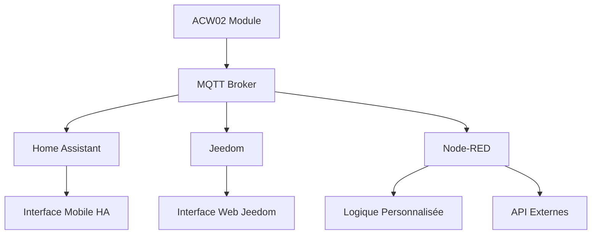

# 🔬 Fonctionnalités Avancées ACW02

Pour les utilisateurs expérimentés souhaitant exploiter pleinement les capacités du module ACW02.

---

## 🎯 Vue d'Ensemble

Cette section couvre les **configurations avancées** et **intégrations spécialisées** :
- **MQTT uniquement** (sans ESPHome natif)
- **Intégration Jeedom** complète
- **Presets personnalisés** avancés
- **Configurations multi-systèmes**

---

## 📚 Guides Disponibles

### 🧩 **[Utilisation MQTT Uniquement](mqtt-only.md)**
*Configuration pour systèmes domotiques tiers*

**Quand l'utiliser :**
- ✅ **Jeedom** avec plugin MQTT
- ✅ **OpenHAB** avec binding MQTT  
- ✅ **Node-RED** pour logique personnalisée
- ✅ **Home Assistant** sans add-on ESPHome
- ✅ **Réseaux complexes** (VLAN, firewall strict)

**Avantages :**
- 🔧 **Compatibilité universelle** avec tous systèmes MQTT
- 🌐 **Indépendance ESPHome** - fonctionne avec MQTT seul
- 🔒 **Sécurité renforcée** - pas d'API ESPHome exposée
- ⚡ **Performance** - moins de protocoles simultanés

**Inconvénients :**
- ❌ **Configuration plus complexe** que ESPHome natif
- ❌ **Pas d'intégration HA automatique** ESPHome
- ❌ **Mise à jour OTA** uniquement via CLI ESPHome

---

### ⚡ **[Intégration Jeedom](jeedom-integration.md)**
*Guide complet pour utilisateurs Jeedom*

**Ce que vous apprendrez :**
- 🔌 **Configuration plugins** MQTT Discovery/Manager
- 🏠 **Auto-découverte équipements** via topics Home Assistant
- 🎛️ **Contrôles natifs** Jeedom pour climatisation
- 🤖 **Scénarios avancés** avec logique météo/présence
- 📱 **Widgets mobiles** personnalisés
- 🔧 **Debug et monitoring** spécifique Jeedom

**Prérequis :**
- Jeedom Core 4.2+ recommandé
- Plugin MQTT Broker installé
- Plugin MQTT Discovery (fortement recommandé)
- Module ACW02 en mode MQTT-only

---

### 🎨 **[Configuration Presets Personnalisés](custom-presets.md)**
*Créer et gérer des configurations climatisation avancées*

**Presets recommandés :**
- 🌙 **\"Nuit\"** - Confort sommeil (24°C, silencieux, oscillation off)
- 🏠 **\"Confort\"** - Usage quotidien (22°C, auto, oscillation on)
- 💚 **\"Éco\"** - Économie énergie (26°C été/19°C hiver, éco on)
- 🚀 **\"Turbo\"** - Refroidissement rapide (18°C, ventilateur max)
- 🏢 **\"Travail\"** - Bureau optimal (23°C, discret, oscillation ciblée)

**Fonctionnalités avancées :**
- 🤖 **Automations temporelles** - Presets selon heure
- 👥 **Presets selon présence** - Adaptation automatique  
- 📊 **Monitoring usage** - Statistiques utilisation
- 🎮 **Interface personnalisée** - Boutons rapides Lovelace
- 💾 **Sauvegarde/restauration** - Documentation presets

---

## 🚀 Cas d'Usage Avancés

### 🏢 **Installation Multi-Zones**
```yaml
# Configuration pour plusieurs climatiseurs
# acw02-salon.yaml
substitutions:
  dev_name: \"acw02-salon\"
  mqtt_prefix: \"salon\"

# acw02-chambre.yaml  
substitutions:
  dev_name: \"acw02-chambre\"
  mqtt_prefix: \"chambre\"

# acw02-bureau.yaml
substitutions:
  dev_name: \"acw02-bureau\" 
  mqtt_prefix: \"bureau\"
```

### 🌡️ **Gestion Climatique Intelligente**
```yaml
# Home Assistant automation multi-zones
- alias: \"Gestion climatique centralisée\"
  trigger:
    - platform: numeric_state
      entity_id: sensor.temperature_exterieure
      above: 28
  condition:
    - condition: time
      after: \"08:00:00\"
      before: \"22:00:00\"
  action:
    - service: climate.set_preset_mode
      target:
        entity_id:
          - climate.acw02_salon
          - climate.acw02_chambre
      data:
        preset_mode: \"Éco\"
    - service: climate.set_temperature
      target:
        entity_id: climate.acw02_bureau
      data:
        temperature: \"{{ 25 - (states('sensor.temperature_exterieure')|float - 28) * 0.5 }}\"
```

### 🔌 **Intégration Domotique Hybride**


---

## 🔧 Configurations Spécialisées

### 🌐 **Réseau VLAN/Segmenté**
```yaml
# Configuration pour réseaux d'entreprise
wifi:
  ssid: !secret wifi_iot_ssid
  password: !secret wifi_iot_password
  manual_ip:
    static_ip: 10.20.30.150      # Réseau IoT dédié
    gateway: 10.20.30.1
    subnet: 255.255.255.0
    dns1: 10.20.1.1              # DNS interne

mqtt:
  broker: 10.20.1.100            # Broker sur réseau management
  username: !secret mqtt_iot_user
  password: !secret mqtt_iot_password
  port: 8883                     # MQTT over TLS
```

### 🔒 **Sécurité Renforcée**
```yaml
# Configuration sécurisée pour environnements sensibles
api:
  encryption:
    key: !secret api_key_unique_per_device
  
ota:
  - platform: esphome
    password: !secret ota_password_complex
    port: 3232                   # Port non-standard
    
web_server:
  port: 8080                     # Port non-standard
  version: 3
  auth:
    username: !secret web_admin_user
    password: !secret web_admin_password_complex
  include_internal: false        # Cacher capteurs internes
```

### 📊 **Monitoring Avancé**
```yaml
# Surveillance complète du module
sensor:
  # Performance réseau
  - platform: wifi_signal
    name: \"Signal Wi-Fi Force\"
    update_interval: 30s
    
  # Santé système
  - platform: uptime
    name: \"Durée Fonctionnement\"
    
  - platform: internal_temperature
    name: \"Température ESP32\"
    
  # Statistiques UART
  - platform: template
    name: \"Commandes UART Total\"
    lambda: |-
      static int uart_commands = 0;
      return ++uart_commands;
    update_interval: 60s
    
  # Monitoring mémoire
  - platform: template
    name: \"Mémoire Libre Pourcentage\"
    lambda: |-
      return (float(ESP.getFreeHeap()) / float(ESP.getHeapSize())) * 100.0;
    unit_of_measurement: \"%\"
    
binary_sensor:
  # Alertes système
  - platform: template
    name: \"Alerte Température ESP32\"
    lambda: |-
      return id(esp32_temp).state > 70.0;  # Alerte si > 70°C
      
  - platform: template  
    name: \"Alerte Mémoire Faible\"
    lambda: |-
      return ESP.getFreeHeap() < 20000;    # Alerte si < 20KB libre
```

---

## 🛠️ Outils de Développement

### 📝 **Scripts d'Administration**
```bash
#!/bin/bash
# admin_acw02.sh - Script d'administration multiple modules

MODULES=(\"acw02-salon\" \"acw02-chambre\" \"acw02-bureau\")
MQTT_BROKER=\"192.168.1.100\"

# Fonction ping tous les modules
ping_all() {
    for module in \"${MODULES[@]}\"; do
        if ping -c 1 \"$module.local\" >/dev/null 2>&1; then
            echo \"✅ $module - Online\"
        else
            echo \"❌ $module - Offline\"
        fi
    done
}

# Fonction mise à jour OTA tous les modules
update_all() {
    for module in \"${MODULES[@]}\"; do
        echo \"Mise à jour $module...\"
        esphome run \"$module.yaml\" --device OTA
    done
}

# Fonction backup configuration tous les modules  
backup_all() {
    mkdir -p \"backup/$(date +%Y%m%d)\"
    for module in \"${MODULES[@]}\"; do
        cp \"$module.yaml\" \"backup/$(date +%Y%m%d)/\"
    done
    echo \"Sauvegarde terminée dans backup/$(date +%Y%m%d)/\"
}

case $1 in
    \"ping\") ping_all ;;
    \"update\") update_all ;;  
    \"backup\") backup_all ;;
    *) echo \"Usage: $0 {ping|update|backup}\" ;;
esac
```

### 🔍 **Monitoring MQTT**
```python
#!/usr/bin/env python3
# mqtt_monitor.py - Surveillance temps réel tous modules ACW02

import paho.mqtt.client as mqtt
import json
from datetime import datetime

BROKER = \"192.168.1.100\"
MODULES = [\"acw02-salon\", \"acw02-chambre\", \"acw02-bureau\"]

def on_connect(client, userdata, flags, rc):
    print(f\"Connecté au broker MQTT (code {rc})\")
    
    # S'abonner aux topics de statut
    for module in MODULES:
        client.subscribe(f\"homeassistant/climate/{module}/state\")
        client.subscribe(f\"{module}/status\")
        
def on_message(client, userdata, msg):
    timestamp = datetime.now().strftime(\"%H:%M:%S\")
    topic = msg.topic
    payload = msg.payload.decode()
    
    # Identifier le module depuis le topic
    module = None
    for mod in MODULES:
        if mod in topic:
            module = mod
            break
            
    if \"state\" in topic and module:
        try:
            data = json.loads(payload)
            temp = data.get('temperature', 'N/A')
            mode = data.get('mode', 'N/A')
            print(f\"[{timestamp}] {module}: {mode} - {temp}°C\")
        except json.JSONDecodeError:
            print(f\"[{timestamp}] {module}: {payload}\")
    elif \"status\" in topic:
        status_icon = \"🟢\" if payload == \"online\" else \"🔴\"
        print(f\"[{timestamp}] {status_icon} {module}: {payload}\")

client = mqtt.Client()
client.on_connect = on_connect
client.on_message = on_message

try:
    client.connect(BROKER, 1883, 60)
    print(\"Monitoring ACW02 - Ctrl+C pour arrêter\")
    client.loop_forever()
except KeyboardInterrupt:
    print(\"\\nArrêt du monitoring\")
    client.disconnect()
```

---

## 📈 Performance et Optimisation

### ⚡ **Optimisation Réseau**
- **Channel Wi-Fi** : Utiliser 1, 6, ou 11 pour éviter interférences
- **Puissance TX** : 20dBm max, réduire si signal trop fort
- **Fast Connect** : Activer pour reconnexion rapide
- **QoS MQTT** : QoS 1 pour commandes critiques

### 🧠 **Optimisation Mémoire**  
- **Logger level WARN** : Réduire verbosité logs
- **Désactiver composants** non utilisés
- **Optimiser update_interval** : Pas < 10s sauf nécessaire
- **Nettoyer build cache** : `esphome clean` si problèmes

### 🔧 **Optimisation Communication**
- **Délais UART** : 300-500ms optimal pour la plupart
- **Batch commands** : Éviter commandes simultanées
- **Heartbeat MQTT** : Will message pour détection pannes
- **Topics retain** : Activer pour états critiques

---

## 🆘 Support Avancé

### 🐛 **Debug Avancé**
```yaml
# Configuration debug maximale (temporaire)
logger:
  level: DEBUG
  logs:
    mqtt: DEBUG
    climate: DEBUG
    uart: VERBOSE
    
# Capteur debug UART
uart:
  id: uart_bus
  tx_pin: ${TX}
  rx_pin: ${RX}
  baud_rate: 9600
  debug:                    # Active logs UART
    direction: BOTH
    dummy_receiver: false
    after:
      delimiter: \"\\n\"
    sequence:
      - lambda: UARTDebug::log_hex(direction, bytes, ':');
```

### 📞 **Ressources Support**
- **[Issues GitHub](https://github.com/devildant/acw02_esphome/issues)** - Bugs et problèmes techniques
- **[Discussions GitHub](https://github.com/devildant/acw02_esphome/discussions)** - Questions avancées
- **[ESPHome Discord](https://discord.gg/KhAMKrd)** - Support ESPHome général
- **[Home Assistant Forum](https://community.home-assistant.io/c/esphome/)** - Communauté ESPHome

---

## 🔗 Navigation

### 📖 **Retour Documentation Principale**
- **[Guide Installation](../installation/)** - Méthodes d'installation
- **[Configuration Hardware](../hardware/)** - Choix composants
- **[Utilisation Quotidienne](../usage/)** - Guides utilisateur

### 🛠️ **Ressources Techniques**  
- **[Fichiers PCB](../../hardware_new/pcb/)** - Cartes électroniques
- **[Fichiers 3D](../../hardware_new/3d-files/)** - Boîtiers impression  
- **[Outils](../../tools_new/)** - Scripts et utilitaires