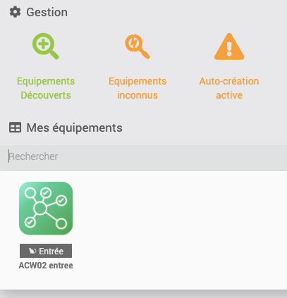
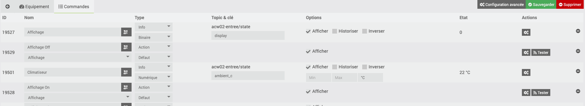
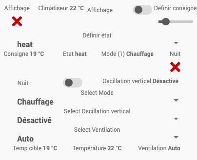

# ⚡ Intégration Jeedom

Guide complet pour intégrer le module ACW02 avec Jeedom via MQTT.

---

## 📋 Prérequis

### Plugins Jeedom Requis
- 🔌 **Plugin MQTT Broker** - Obligatoire
- 🧭 **Plugin MQTT Discovery** - Fortement recommandé pour auto-découverte
- 📊 **Plugin MQTT Manager** - Optionnel mais utile

### Configuration Préalable
- ✅ **Broker MQTT** configuré et fonctionnel dans Jeedom
- ✅ **Module ACW02** configuré en **[mode MQTT-only](mqtt-only.md)**
- ✅ **Réseau** : ESP32 et Jeedom sur le même réseau/VLAN

---

## 🚀 Installation et Configuration

### 1️⃣ Installation des Plugins

#### Plugin MQTT Discovery
1. **Aller dans** : Plugins → Gestion des plugins
2. **Market** → Rechercher \"MQTT Discovery\"
3. **Installer** et **Activer** le plugin
4. **Configuration** :
   ```
   Broker MQTT : 127.0.0.1:1883 (ou IP de votre broker)
   Topic racine : homeassistant
   Découverte automatique : ✅ Activée
   ```

#### Plugin MQTT Manager (Optionnel)
- **Utile pour** : Gestion avancée topics, debug, monitoring
- **Installation** : Même procédure que MQTT Discovery

---

### 2️⃣ Configuration ESP32 (Mode MQTT-Only)

#### Modification du Firmware
Suivez le **[guide MQTT-only](mqtt-only.md#-configuration-yaml)** pour :
1. **Supprimer l'API ESPHome** du YAML
2. **Recompiler** et flasher l'ESP32
3. **Activer G2** dans l'interface web

#### Configuration MQTT sur ESP32
Interface web ESP32 → Configuration :
```
MQTT IP : 192.168.1.100 (IP de Jeedom)
MQTT Username : jeedom
MQTT Password : votre_mot_de_passe_mqtt
MQTT Port : 1883
```

**Important** : Activer **\"G2: Enable MQTT version\"** ✅

---

### 3️⃣ Configuration Broker MQTT dans Jeedom

#### Via Plugin MQTT Manager
```
Configuration → Broker MQTT :
- IP : 127.0.0.1 (Jeedom local)
- Port : 1883  
- Utilisateur : jeedom
- Mot de passe : [mot de passe sécurisé]
- Client ID : jeedom_broker
```

#### Créer Utilisateur pour ESP32
```
Utilisateurs MQTT :
- Nom : acw02_user
- Mot de passe : acw02_password_secure123
- Droits : Lecture/Écriture sur homeassistant/#
```

---

## 🔍 Auto-Découverte

### Via Plugin MQTT Discovery

Une fois configuré, Jeedom détecte **automatiquement** :



#### Équipements Auto-Détectés
- **climate.acw02_salon** - Contrôle principal climatisation
- **sensor.acw02_salon_temperature** - Capteur température  
- **switch.acw02_salon_display** - Contrôle affichage
- **select.acw02_salon_swing_h** - Oscillation horizontale
- **binary_sensor.acw02_salon_filter** - État filtre
- **Et tous les autres capteurs/contrôles...**

### Configuration Manuelle Discovery
Si auto-discovery ne fonctionne pas :

1. **Plugin MQTT Discovery** → Configuration
2. **Ajouter manuellement** :
   ```
   Topic : homeassistant/climate/acw02_salon/config
   Nom : acw02-salon
   ```
3. **Lancer scan** manuel

---

## 🎛️ Contrôles Disponibles

### Commandes Principales



| Commande Jeedom | Topic MQTT | Description |
|------------------|------------|-------------|
| **Mode** | `homeassistant/climate/acw02_salon/mode/set` | off, cool, heat, auto, dry, fan_only |
| **Température** | `homeassistant/climate/acw02_salon/temperature/set` | 16-32°C |
| **Vitesse Ventilateur** | `homeassistant/select/acw02_salon_fan_speed/command` | auto, 1, 2, 3, 4, 5 |
| **Oscillation H** | `homeassistant/select/acw02_salon_swing_h/command` | On, Off |
| **Preset** | `homeassistant/select/acw02_salon_preset/command` | Nuit, Confort, Éco... |

### Capteurs Disponibles  

| Capteur Jeedom | Topic MQTT | Type |
|----------------|------------|------|
| **Température Ambiante** | `homeassistant/sensor/acw02_salon_temperature/state` | Numérique (°C) |
| **État Filtre** | `homeassistant/binary_sensor/acw02_salon_filter/state` | Binaire (OK/Nettoyage) |
| **Signal Wi-Fi** | `homeassistant/sensor/acw02_salon_wifi_signal/state` | Numérique (dBm) |
| **Statut Connexion** | `acw02_salon/status` | Texte (online/offline) |

---

## 📊 Interface Jeedom

### Équipement Principal



#### Configuration Équipement  
```
Nom : Climatisation Salon
Catégorie : Confort → Climatisation
Objet parent : Salon (ou autre)
Activer : ✅
Visible : ✅
```

#### Commandes Personnalisées
```json
// Commande \"Allumer Cool 22°C\" (action)
{
    \"topic\": \"homeassistant/climate/acw02_salon/mode/set\",
    \"message\": \"cool\"
},
{
    \"topic\": \"homeassistant/climate/acw02_salon/temperature/set\", 
    \"message\": \"22\"
}
```

### Widget Personnalisé

#### Template Widget Climatisation
```html
<!-- Widget Jeedom pour climatisation -->
<div class=\"climate-widget\">
    <div class=\"temperature\">
        <span class=\"current\">#[temperature]#°C</span>
        <span class=\"target\">(#[target_temp]#°C)</span>
    </div>
    
    <div class=\"controls\">
        <button onclick=\"jeedom.cmd.execute({id: '#[cmd_cool]#'})\">❄️ Cool</button>
        <button onclick=\"jeedom.cmd.execute({id: '#[cmd_heat]#'})\">🔥 Heat</button>
        <button onclick=\"jeedom.cmd.execute({id: '#[cmd_off]#'})\">⏹️ Off</button>
    </div>
    
    <div class=\"mode\">
        Mode: <span class=\"current-mode\">#[mode]#</span>
    </div>
</div>
```

---

## 🤖 Scénarios Jeedom

### Scénario \"Mode Nuit Automatique\"

#### Déclencheur
- **Heure** : 22h30
- **Condition** : Climatisation allumée ET température > 25°C

#### Actions
```php
// Action 1 : Mode nuit
$mqtt = mqtt();
$mqtt->publish('homeassistant/select/acw02_salon_preset/command', 'Nuit');
message::add('Climatisation', 'Mode nuit activé automatiquement');

// Action 2 : Réduire température si nécessaire  
$temp_actuelle = cmd::byString('#[salon][Climatisation Salon][Température]#')->execCmd();
if ($temp_actuelle > 26) {
    $mqtt->publish('homeassistant/climate/acw02_salon/temperature/set', '24');
}
```

### Scénario \"Extinction Automatique\"

#### Déclencheur  
- **Capteur présence** : Absence > 2 heures
- **Ou heure** : 01h00

#### Actions
```php
// Vérifier si climatisation allumée
$mode = cmd::byString('#[salon][Climatisation Salon][Mode]#')->execCmd();

if ($mode != 'off') {
    // Éteindre progressivement
    $mqtt = mqtt();
    
    // Monter température puis éteindre (évite choc thermique)
    $mqtt->publish('homeassistant/climate/acw02_salon/temperature/set', '26');
    sleep(300); // Attendre 5 minutes
    $mqtt->publish('homeassistant/climate/acw02_salon/mode/set', 'off');
    
    message::add('Climatisation', 'Extinction automatique - absence détectée');
}
```

---

## 📱 Application Mobile Jeedom

### Configuration Widget Mobile
```json
// Configuration widget Jeedom Mobile
{
    \"type\": \"climate\",
    \"name\": \"Climatisation Salon\", 
    \"temperature_sensor\": \"#[salon][Climatisation Salon][Température]#\",
    \"mode_command\": \"#[salon][Climatisation Salon][Mode]#\",
    \"temperature_command\": \"#[salon][Climatisation Salon][Consigne]#\",
    \"presets\": [\"Off\", \"Cool\", \"Heat\", \"Auto\", \"Nuit\", \"Confort\"]
}
```

### Raccourcis Actions Rapides
- **🏠 Arrivée maison** : Cool 22°C
- **🌙 Coucher** : Mode Nuit  
- **🚗 Départ** : Off après 30min
- **🔥 Hiver** : Heat 21°C

---

## 🔧 Debug et Monitoring

### Surveillance Topics MQTT

#### Via Plugin MQTT Manager
```
Topics à surveiller :
✅ homeassistant/climate/acw02_salon/state
✅ acw02_salon/status  
✅ homeassistant/sensor/acw02_salon_temperature/state
⚠️ homeassistant/+/acw02_salon/+/error (erreurs)
```

#### Logs Jeedom Utiles
```bash
# Logs MQTT Discovery
tail -f /var/www/html/log/mqttDiscovery

# Logs MQTT Manager  
tail -f /var/www/html/log/mqtt

# Test manuel topics
mosquitto_sub -h localhost -t \"homeassistant/+/acw02_salon/+\"
```

### Diagnostic Problèmes

#### Équipement Non Détecté
1. **Vérifier broker MQTT** actif dans Jeedom
2. **Contrôler configuration ESP32** (G2 activé)
3. **Tester topics manuellement** avec mosquitto
4. **Relancer découverte** MQTT Discovery

#### Commandes Non Fonctionnelles
1. **Vérifier droits MQTT** utilisateur Jeedom
2. **Contrôler réseau** (ping ESP32 depuis Jeedom)
3. **Tester via interface web** ESP32 directement
4. **Examiner logs** Jeedom et ESP32

---

## 💡 Conseils d'Optimisation

### Performance
- **QoS MQTT** : Utiliser QoS 1 pour commandes critiques
- **Retain messages** : Activer pour états importants
- **Heartbeat** : Surveiller `acw02_salon/status` 

### Sécurité
- **Utilisateurs MQTT dédiés** par équipement
- **Mots de passe forts** et changés régulièrement  
- **Chiffrement TLS** si MQTT externe à Jeedom

### Maintenance
- **Sauvegarder configuration** Jeedom régulièrement
- **Surveiller logs** pour détection pannes
- **Tester scénarios** après mises à jour

---

## 🆘 Support et Dépannage

### Problèmes Courants

#### \"Équipement découvert mais inactif\"
```php
// Script diagnostic Jeedom
$mqtt = mqtt();
$status = $mqtt->subscribe('acw02_salon/status', 5); // Timeout 5s
if ($status == 'online') {
    echo \"ESP32 accessible\";
} else {
    echo \"ESP32 hors ligne ou inaccessible\";
}
```

#### \"Commandes sans effet\"
1. **Vérifier mode silencieux** ESP32 (désactiver)
2. **Contrôler délais** communication UART
3. **Tester télécommande** originale

### Ressources d'Aide
- **[Forum Jeedom](https://community.jeedom.com/)** - Support communauté
- **[Issues GitHub ACW02](https://github.com/devildant/acw02_esphome/issues)** - Problèmes spécifiques module
- **[Guide MQTT-only](mqtt-only.md)** - Configuration MQTT avancée

---

## 🔗 Prochaines Étapes

1. **[Optimiser les presets](custom-presets.md)** - Créer configurations personnalisées
2. **[Monitoring avancé](../usage/troubleshooting.md#-outils-de-diagnostic)** - Surveillance système  
3. **[Intégration domotique](mqtt-only.md#-node-red-integration)** - Logique complexe avec Node-RED