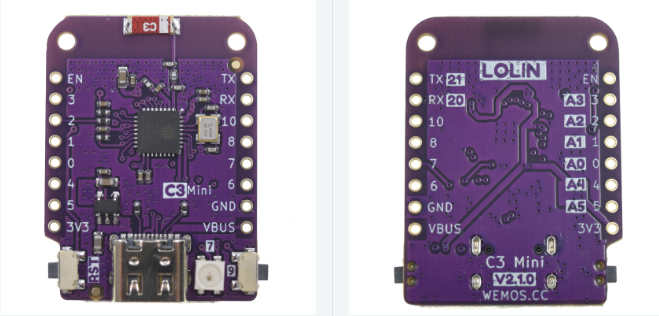

# LOLIN ESP32 C3 Mini

## 🚀 Carte avec Meilleur Signal Wi-Fi

La **LOLIN ESP32 C3 Mini** offre un signal Wi-Fi amélioré par rapport à l'ESP32 D1 Mini, tout en conservant un bouton reset intégré dans le boîtier.

---

## 🧩 Carte PCB

### 📂 Fichiers Gerber disponibles dans le répertoire `PCB/` :

#### 🟢 Version stable (v1.0) :
📥 [Télécharger le fichier GERBER](https://github.com/devildant/acw02_esphome/raw/main/PCB/lolin_c3_xiao_c3_xiao_c6/v1.0/Gerber_climEspHome_esp32_lolin_c3_xiao_c3_c6_PCB_climEspHome_esp32_lolin_c3_xiao_c3_2025-09-27.zip)

  


---

## 📦 Composants Nécessaires

### LOLIN ESP32 C3 Mini
- **[LOLIN ESP32 C3 Mini (x1)](https://www.wemos.cc/en/latest/c3/c3_mini.html)**  
  

### Autres Composants
- **[Régulateur 12V → 5V D24V10F5 (x1)](https://shop.mchobby.be/fr/regulateurs/554--regul-5v-1a-step-down-d24v10f5-3232100005549-pololu.html)**  
- **Convertisseur de Niveau Logique** (même options que ESP32 D1 Mini)
- **[Broches mâles 8 pins 2.54mm (x2)](https://fr.aliexpress.com/item/1005007128029220.html)**  
  

---

## ⚙️ Avantages et Inconvénients

### ✅ Avantages
- **Meilleur signal Wi-Fi** comparé à l'ESP32 D1 Mini WROOM 32
- **Bouton reset intégré** dans le boîtier 3D
- **Puce ESP32-C3** plus récente et efficace énergétiquement
- **Moins de clones de mauvaise qualité** sur le marché
- **Architecture RISC-V** moderne

### ❌ Inconvénients
- **Pas de support d'antenne externe**
- **Moins testé** que la version ESP32 D1 Mini (mais stable)
- **Prix légèrement supérieur**
- **Disponibilité parfois limitée**

---

## 🔌 Câblage et Soudure PCB

### Code Couleur des Câbles
- **ROUGE** = 12V  
- **NOIR** = RX  
- **JAUNE** = TX  
- **VERT** = GND

### Schéma de Câblage


### Configuration YAML
```yaml
substitutions:
  # LOLIN ESP32 C3 MINI
  board: lolin_c3_mini
  TX: GPIO21
  RX: GPIO20
```

---

## 🖨️ Fichiers 3D pour LOLIN ESP32 C3

### Boîtier Partagé
La LOLIN C3 utilise le **même boîtier** que les cartes XIAO (C3/C6), disponible dans :  
`3Dfiles/LOLIN-C3-XIAO-C3-C6/`

#### Accessoires Spécifiques
- **[Bouton reset LOLIN C3 (.stl)](https://github.com/devildant/acw02_esphome/raw/main/3Dfiles/LOLIN-C3-XIAO-C3-C6/button%20lolin%20c3.stl)**
- **[Support de soudure ESP32 C3-C6 (.stl)](https://github.com/devildant/acw02_esphome/raw/main/3Dfiles/LOLIN-C3-XIAO-C3-C6/solder%20board%20ESP32%20C3-C6.stl)**

### 📸 Photos de Montage
  


---

## 🔧 Spécifications Techniques

### Microcontrôleur
- **Puce** : ESP32-C3FH4 (RISC-V single-core 160 MHz)
- **Mémoire Flash** : 4 MB
- **RAM** : 400 KB SRAM
- **Wi-Fi** : 802.11 b/g/n (2.4 GHz)
- **Bluetooth** : Bluetooth 5.0 LE

### Connectivité
- **GPIO** : 13 pins numériques
- **ADC** : 5 canaux 12-bit
- **SPI** : 1x SPI
- **I2C** : 1x I2C
- **UART** : 2x UART
- **USB** : USB-C natif (pas de convertisseur série)

### Alimentation
- **Tension d'entrée** : 5V via USB-C ou pin 5V
- **Tension de fonctionnement** : 3.3V
- **Courant de fonctionnement** : ~80mA (Wi-Fi actif)

---

## 📋 Comparaison avec Autres Cartes

| Caractéristique | ESP32 D1 Mini | **LOLIN C3** | XIAO C3 | XIAO C6 |
|------------------|---------------|--------------|---------|---------|
| **Signal Wi-Fi** | ⭐⭐⭐ | ⭐⭐⭐⭐ | ⭐⭐⭐⭐⭐ | ⭐⭐⭐ |
| **Bouton Reset** | ✅ | ✅ | ❌ | ❌ |
| **Antenne Externe** | ❌ | ❌ | ✅ | ✅ |
| **Prix** | € | €€ | €€€ | €€€€ |
| **Disponibilité** | ⭐⭐⭐⭐⭐ | ⭐⭐⭐⭐ | ⭐⭐⭐ | ⭐⭐ |

---

## 💡 Quand Choisir la LOLIN C3

### ✅ Recommandé Si
- Vous avez des **problèmes de signal Wi-Fi** avec l'ESP32 D1 Mini
- Vous voulez un **bouton reset** dans le boîtier
- Vous préférez une **architecture plus moderne** (RISC-V)
- Votre climatiseur est **éloigné du routeur Wi-Fi**

### ❌ Éviter Si
- Votre ESP32 D1 Mini **fonctionne déjà bien**
- Vous avez besoin d'une **antenne externe** (préférez XIAO C3)
- Le **budget est serré** (ESP32 D1 Mini suffit)
- Vous voulez la solution **la plus documentée** (ESP32 D1 Mini)

---

## 🛒 Où Acheter

### 🛒 Fournisseurs Recommandés
- **[Site officiel WEMOS](https://www.wemos.cc/en/latest/c3/c3_mini.html)** - Source officielle
- **[AliExpress - Store WEMOS](https://fr.aliexpress.com/store/1331105)** - Store officiel
- **Distributeurs européens** - Recherchez \"LOLIN ESP32 C3 mini\"

### 💰 Fourchette de Prix
- **Prix typique** : 8-12€
- **Attention** : Évitez les prix < 6€ (probablement des contrefaçons)

---

## 🔧 Installation et Configuration

### 1️⃣ Prérequis Pilotes
La LOLIN C3 utilise un **USB-C natif** (pas de puce convertisseur), donc :
- **Aucun pilote supplémentaire** nécessaire sur la plupart des systèmes
- **Détection automatique** sur macOS, Linux, Windows 10+

### 2️⃣ Configuration ESPHome
```yaml
# Dans votre fichier .yaml
substitutions:
  # Décommentez ces lignes pour LOLIN C3
  board: lolin_c3_mini
  TX: GPIO21
  RX: GPIO20
  
  # Commentez la configuration ESP32 D1 Mini
  # board: esp32dev
  # TX: GPIO17
  # RX: GPIO16
```

### 3️⃣ Compilation
Les temps de compilation sont **similaires** à l'ESP32 D1 Mini.

---

## 🔗 Prochaines Étapes

1. **[Commander le PCB](../../hardware/pcb/)** avec les fichiers Gerber
2. **[Télécharger le boîtier 3D](../../hardware/3d-files/)** LOLIN-C3-XIAO-C3-C6
3. **[Configurer le firmware](../installation/)** avec les bons paramètres
4. **[Tester la connectivité](../usage/troubleshooting.md)** Wi-Fi

---

## 📞 Support et Communauté

- **[Documentation officielle WEMOS](https://www.wemos.cc/en/latest/c3/c3_mini.html)**
- **[Forum ESPHome](https://community.home-assistant.io/c/esphome/)**
- **[Issues GitHub du projet](https://github.com/devildant/acw02_esphome/issues)**