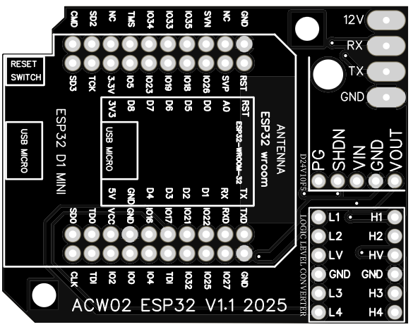
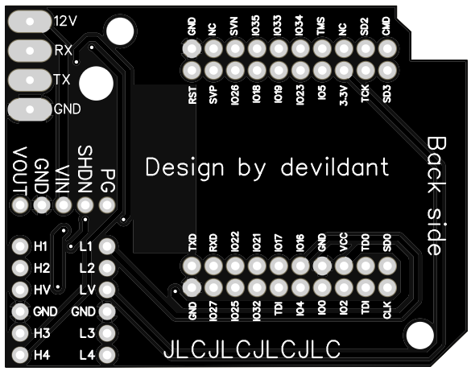
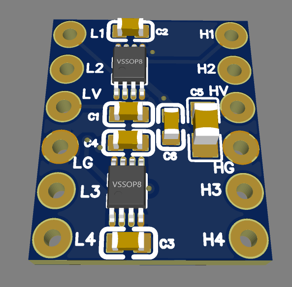

# ESP32 D1 Mini WROOM 32

## 🏆 Version Recommandée pour Débutants

L'**ESP32 D1 Mini WROOM 32** est la carte la plus testée et recommandée pour commencer avec ce projet.

---

## 🧩 Carte PCB

### 📂 Fichiers Gerber disponibles dans le répertoire `PCB/` :

#### 🟢 Version stable (v1.0) :
📥 [Télécharger le fichier GERBER](https://github.com/devildant/acw02_esphome/raw/main/PCB/esp32_D1_mini_wroom32/v1.0/Gerber_climEspHome_esp32_d1_mini_PCB_climEspHome_esp32_d1_mini_2025-07-03.zip)

  


#### 🟢 Version stable (v1.1) :
📥 [Télécharger le fichier GERBER](https://github.com/devildant/acw02_esphome/raw/main/PCB/esp32_D1_mini_wroom32/v1.1/Gerber_climEspHome_esp32_d1_mini_v1.1_PCB_climEspHome_esp32_d1_mini_v1.1_2025-09-08.zip)
 
> Cette révision supprime les pistes et couches de cuivre sous l'**antenne ESP32** pour potentiellement améliorer le signal Wi-Fi.  
> Cependant, comme l'antenne est déjà surélevée au-dessus du PCB par les broches, l'amélioration peut être négligeable.  
> Le PCB est **commandé mais pas encore testé**. 

  


---

## 📦 Composants Nécessaires

### ESP32 D1 Mini WROOM 32
- **[ESP32-WROOM-32 D1 Mini NodeMCU (version micro USB recommandée) (x1)](https://amzn.eu/d/3mS1B7W)**  
  

### ⚠️ **Avertissement de Compatibilité**  
Évitez les clones ESP32 D1 Mini très bon marché (souvent trouvés sur AliExpress).  
Plusieurs utilisateurs ont signalé des problèmes avec ces cartes.  
Préférez des marques reconnues comme **AZDelivery** ou d'autres fournisseurs bien notés.

#### ❌ Symptômes d'incompatibilité des ESP32 bas de gamme
- Le Wi-Fi ne peut pas être activé sur la climatisation (le logo Wi-Fi n'apparaît jamais)
- La LED ESP s'allume brièvement, puis s'éteint
- La tension sur VCC chute de 5 V à ~1.8–2 V lorsque connecté à la carte de climatisation

#### 🛠️ Pourquoi cela arrive-t-il ?
Les clones ESP32 D1 Mini bon marché économisent sur les **composants de régulation** et la **stabilité** :
- *Régulateur 5 V → 3.3 V faible* — les anciens régulateurs AMS1117 gaspillent l'énergie et ne peuvent pas gérer les pics de courant Wi-Fi
- *Condensateurs de découplage de mauvaise qualité* — les cartes bon marché manquent des condensateurs nécessaires pour lisser les pics rapides
- *Modules ESP32 incohérents* — certains clones utilisent des puces non-authentiques ou de qualité B

#### ✅ Pourquoi AZDelivery et les marques reconnues fonctionnent
- Utilisent des modules **Espressif WROOM-32** originaux
- Incluent un **régulateur LDO moderne** qui tolère les pointes jusqu'à 500–600 mA
- Condensateurs appropriés assurent un fonctionnement stable pendant l'activité Wi-Fi
- Résultat : même alimentés depuis le port 12 V limité de la climatisation, ils restent stables et se connectent sans problème

### Autres Composants
- **[Régulateur 12V → 5V D24V10F5 (x1)](https://shop.mchobby.be/fr/regulateurs/554--regul-5v-1a-step-down-d24v10f5-3232100005549-pololu.html)**  
  [Site du fabricant](https://www.pololu.com/product/2831)  
  

- **Convertisseur de Niveau Logique 4 Canaux (x1)**
  
  > **2 options disponibles :**  
  > Vous pouvez soit choisir un module prêt basé sur le CYT1076,  
  > soit utiliser une carte personnalisée (à assembler par JLCPCB) conçue autour de deux SN74LVC2T45DCUR.  
  > En pratique, la seconde solution est bien plus optimisée pour la communication UART.  
  > Personnellement, je recommande cette option : un peu plus chère mais beaucoup plus efficace.

  - **Option 1 : [Convertisseur 4 Canaux Bi-Directionnel CYT1076](https://amzn.eu/d/2MhG08s)**  
    

  - **Option 2 : Convertisseur Personnalisé SN74LVC2T45DCUR**  
      
    - 📥 [Télécharger ZIP (GERBER, BOM, Pick & Place)](https://github.com/devildant/acw02_esphome/raw/main/PCB/logic_level_converter/uart_conv_gerber_BOM_PickAndPlace.zip)
    - 👉 [Guide d'Assemblage JLCPCB](jlcpcb-guide.md)

### Connecteurs et Accessoires
- **[Broches mâles 5 pins 2.54mm (x1)](https://fr.aliexpress.com/item/1005007128029220.html)**  
  

- **[Broches mâles 6 pins 2.54mm (x2)](https://fr.aliexpress.com/item/1005007128029220.html)**  
  

- **[Connecteur JST XA 2.5 mâle 4 pins (Direction inversée) (x1)](https://www.aliexpress.com/item/1005008857984831.html)**  
  

📌 Important : Utilisez le câblage inversé pour l'ordre suivant :  


---

## ⚙️ Avantages et Inconvénients

### ✅ Avantages
- **Version de développement** - La plus testée et documentée
- **Bouton reset intégré** dans le boîtier 3D
- **Compatible avec la plupart des tutoriels** et guides
- **Prix abordable** avec les bonnes marques
- **Nombreux fournisseurs fiables** disponibles

### ❌ Inconvénients
- **Signal Wi-Fi légèrement plus faible** dû à la disposition des composants et à la position de l'antenne
- **Pas de support d'antenne externe**
- **Nombreux clones de mauvaise qualité** sur le marché (éviter)
- **Régulateur 3.3V parfois insuffisant** sur les clones bon marché

---

## 🔌 Câblage et Soudure PCB

### Code Couleur des Câbles
- **ROUGE** = 12V  
- **NOIR** = RX  
- **JAUNE** = TX  
- **VERT** = GND

### Configuration YAML
```yaml
substitutions:
  # ESP32 D1 mini WROOM 32
  board: esp32dev
  TX: GPIO17
  RX: GPIO16
```

---

## 🖨️ Fichiers 3D pour ESP32 D1 Mini

### Disponibles dans `3Dfiles/D1-MIMI/` :

#### Version 1 (Boîtier de base)
- [Bas de boîtier (.stl)](https://github.com/devildant/acw02_esphome/raw/main/3Dfiles/D1-MIMI/Version%201/acw02%20case%20bot.stl)
- [Haut de boîtier (.stl)](https://github.com/devildant/acw02_esphome/raw/main/3Dfiles/D1-MIMI/Version%201/acw02%20case%20top.stl)
- [Alternative : haut avec trou pour câble thermo (.stl)](https://github.com/devildant/acw02_esphome/raw/main/3Dfiles/D1-MIMI/Version%201/acw02%20case%20top%20cable%20with%20thermo.stl)

#### Version 2 (Boîtier avec ventilation)
- [Bas avec flux d'air (.stl)](https://github.com/devildant/acw02_esphome/raw/main/3Dfiles/D1-MIMI/Version%202/acw02%20case%20bot%20with%20air%20flow.stl)
- [Haut avec flux d'air (.stl)](https://github.com/devildant/acw02_esphome/raw/main/3Dfiles/D1-MIMI/Version%202/acw02%20case%20top%20air%20flow.stl)
- [Haut avec câble thermo et flux d'air (.stl)](https://github.com/devildant/acw02_esphome/raw/main/3Dfiles/D1-MIMI/Version%202/acw02%20case%20top%20cable%20with%20thermo%20air%20flow.stl)

#### Accessoires
- [Bouton reset (.stl)](https://github.com/devildant/acw02_esphome/raw/main/3Dfiles/D1-MIMI/button.stl)
- [Support de soudure ESP32 D1 MINI (.stl)](https://github.com/devildant/acw02_esphome/raw/main/3Dfiles/D1-MIMI/solder%20board%20ESP32%20D1%20MINI.stl)

### 📸 Photos de Montage


---

## 📋 Matériel d'Assemblage

### Inserts Filetés
- **[Inserts M2 (OD3.2mm) Longueur 2.5mm x4](https://www.aliexpress.com/item/1005003582355741.html)**  
- **[Inserts M3 (OD4.2mm) Longueur 3mm x2](https://www.aliexpress.com/item/1005003582355741.html)**  

### Vis
- **Vis à tête fraisée M2x6mm (x4)**  
- **Vis M3x4mm (x2)**

### Optionnel
- **[Gaine thermorétractable blanche 4.8mm x 10m](https://amzn.eu/d/8Y1PVUU)**  
  

---

## 🔗 Prochaines Étapes

1. **[Commander ou assembler le PCB](../../hardware/pcb/)**
2. **[Télécharger et imprimer le boîtier 3D](../../hardware/3d-files/)**  
3. **[Configurer le firmware](../installation/)**
4. **[Assembler le module complet](../usage/configuration.md)**

---

## 💡 Conseils d'Achat

### 🛒 Où Acheter (Recommandé)
- **AZDelivery** - Qualité fiable, support client correct
- **Elegoo** - Bonne alternative, bien documenté
- **Espressif officiel** - Le plus cher mais garantie de qualité

### ❌ À Éviter
- **Cartes sans marque sur AliExpress** (< 5€)
- **Vendeurs avec peu de retours**
- **Descriptions vagues** sur les spécifications du régulateur