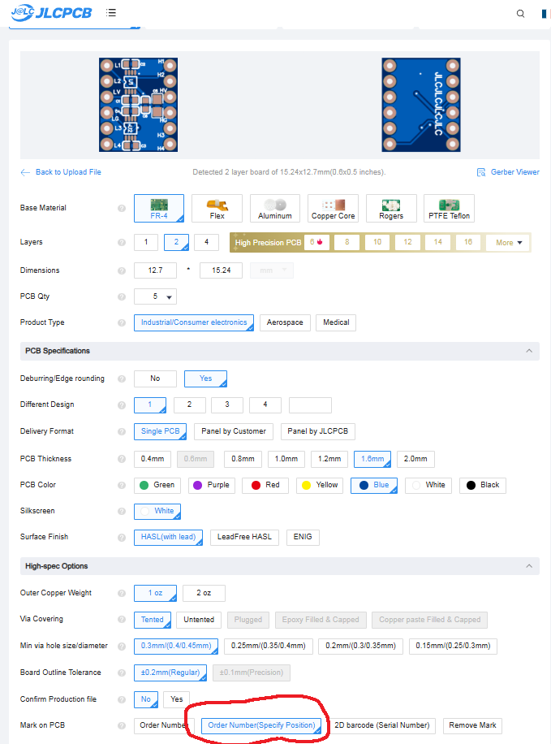
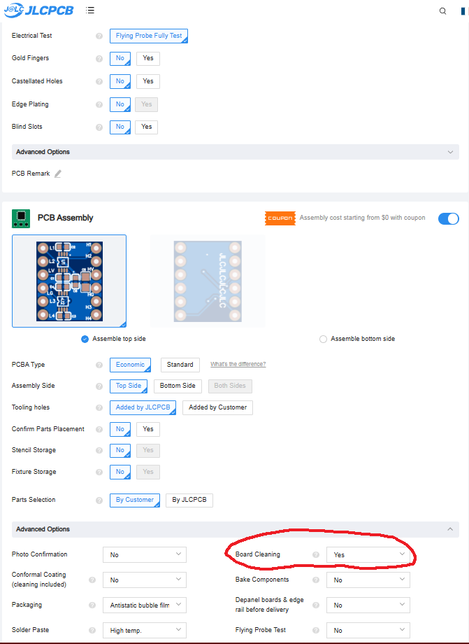
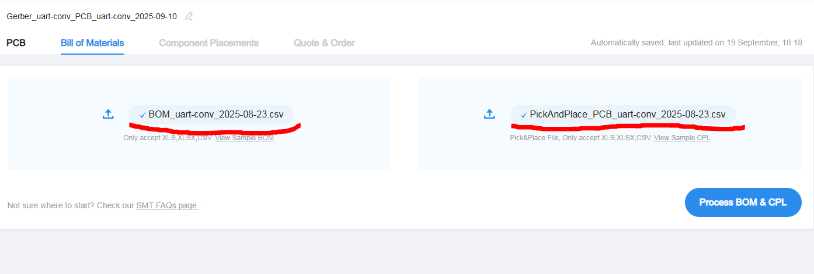
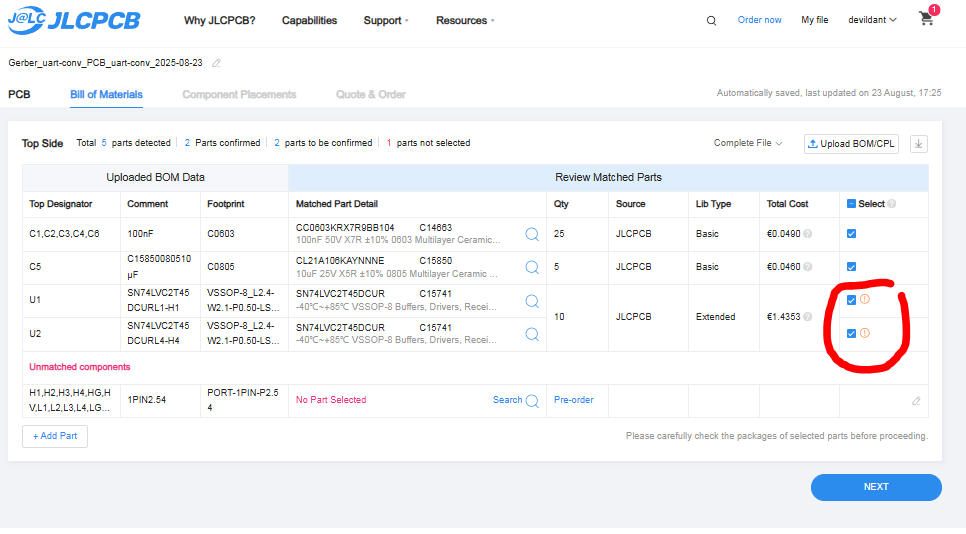
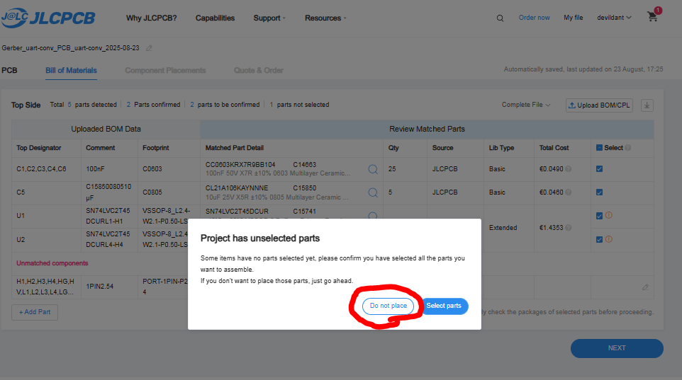
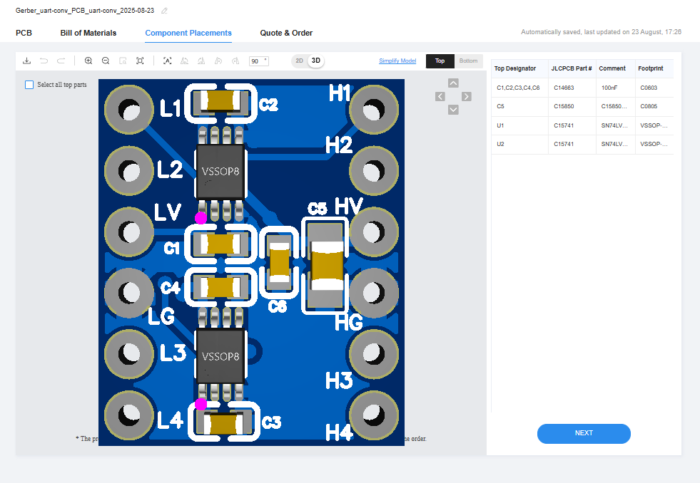

# Guide d'Assemblage JLCPCB - Convertisseur UART

Ce guide vous explique comment faire assembler le convertisseur de niveau logique personnalisé par JLCPCB.

---

## 🎯 Pourquoi ce Convertisseur Personnalisé ?

### Avantages vs Module CYT1076
- **Optimisé pour UART** - Conçu spécifiquement pour la communication série
- **Latence réduite** - Temps de propagation plus faible
- **Meilleure stabilité** - Composants professionnels SN74LVC2T45DCUR
- **Format compact** - S'intègre parfaitement au PCB principal
- **Qualité industrielle** - Assemblage automatisé JLCPCB

### Inconvénients
- **Prix plus élevé** (~10-15€ vs 3-5€ pour CYT1076)
- **Délai de fabrication** (5-10 jours ouvrés)
- **Quantité minimum** (généralement 5 pièces)

---

## 📂 Fichiers Nécessaires

### Téléchargement
📥 [Télécharger le ZIP complet](https://github.com/devildant/acw02_esphome/raw/main/PCB/logic_level_converter/uart_conv_gerber_BOM_PickAndPlace.zip)

### Contenu du ZIP
- **Fichiers Gerber** - Design du PCB
- **BOM (Bill of Materials)** - Liste des composants
- **Pick & Place** - Positions des composants
- **Schéma électrique** - Pour référence

---

## 🛠️ Processus de Commande JLCPCB

### 1️⃣ Téléchargement des Gerber


1. Aller sur [JLCPCB.com](https://jlcpcb.com/)
2. Cliquer sur **\"Instant Quote\"**
3. **Glisser-déposer** le fichier ZIP des Gerber
4. Attendre l'analyse automatique

### 2️⃣ Configuration PCB


**Paramètres recommandés :**
- **PCB Qty** : 5 (minimum)
- **PCB Thickness** : 1.6mm
- **PCB Color** : Green (standard)
- **Surface Finish** : HASL (économique)
- **Remove Order Number** : Specify a location

### 2️⃣bis Options Avancées


- **Via Covering** : Tented
- **Board Outline Tolerance** : ±0.2mm
- **Confirm Production file** : No

### 3️⃣ Activation de l'Assemblage PCB


1. **Activer \"PCB Assembly\"**
2. **Choisir \"Economic\"** (moins cher)
3. **Sélectionner \"Top Side\"** uniquement
4. **Quantity** : Même nombre que PCB
5. **Tooling holes** : Added by JLCPCB

### 4️⃣ Téléchargement BOM et Pick&Place


1. **Upload BOM File** - Choisir le fichier BOM du ZIP
2. **Upload CPL File** - Choisir le fichier Pick&Place du ZIP
3. Cliquer **\"Process BOM & CPL\"**
4. Attendre l'analyse (30-60 secondes)

### 5️⃣ Vérification des Composants


1. **Vérifier que tous les composants** sont détectés (normalement 2 composants)
2. **Contrôler les prix** des composants
3. **Valider les positions** dans le viewer 3D
4. Cliquer **\"Next\"** si tout est correct

---

## 💰 Coût Estimé

### Répartition des Coûts (5 pièces)
- **PCB** : ~2€
- **Assemblage** : ~3-5€  
- **Composants** : ~2-4€
- **Frais de port** : ~8-15€ (selon rapidité)
- **Total** : **15-26€** pour 5 convertisseurs

### Comparaison
- **5x Convertisseur custom** : 15-26€ *(3-5€ par pièce)*
- **5x Module CYT1076** : 15-25€ *(3-5€ par pièce)*

> **💡 Astuce :** Le prix est similaire, mais la qualité est supérieure avec l'assemblage JLCPCB.

---

## ⏱️ Délais de Fabrication

### Options de Production
- **Standard (7-10 jours)** : Le moins cher
- **Express (3-5 jours)** : +50% de coût
- **Super Express (24-48h)** : +100% de coût

### Livraison
- **Standard Post** : 10-20 jours (le moins cher)
- **Express DHL/FedEx** : 3-7 jours (plus cher)

---

## 🔍 Points de Contrôle

### Avant de Valider la Commande

#### ✅ Vérifications Obligatoires
1. **Nombre de composants** : 2 détectés
2. **Preview 3D** : Composants bien positionnés
3. **Prix total** : Cohérent avec l'estimation
4. **Adresse de livraison** : Correcte
5. **Quantité** : Au moins 5 pièces

#### ⚠️ Problèmes Courants
- **Composants non trouvés** → Utiliser les substituts proposés par JLCPCB
- **Prix très élevé** → Vérifier si les composants sont \"Extended Parts\"
- **Erreur de positionnement** → Contacter le support JLCPCB

---

## 📦 Réception et Test

### À la Réception
1. **Vérifier visuellement** les soudures
2. **Contrôler les références** des composants
3. **Tester la continuité** avec un multimètre

### Test Fonctionnel
```
Connecter temporairement :
- VCC (3.3V/5V) → Alimentation
- GND → Masse
- Signaux TX/RX → Test avec oscilloscope (optionnel)
```

### En Cas de Problème
- **Contact JLCPCB** dans les 7 jours
- **Photos haute résolution** des défauts
- **Numéro de commande** à portée de main

---

## 🔧 Intégration au Projet

### Soudure au PCB Principal
Une fois reçu, le convertisseur se soude sur le PCB principal exactement comme un module CYT1076.

### Avantages en Utilisation
- **Stabilité UART améliorée**
- **Moins de déconnexions** série
- **Latence réduite** dans les communications
- **Fiabilité industrielle**

---

## 🆚 Alternative CYT1076

Si vous préférez la **simplicité et le budget** :

### Module CYT1076 Standard
- **[Achat direct](https://amzn.eu/d/2MhG08s)** - Livraison rapide
- **Prix** : 3-5€ par module
- **Disponibilité** : Immédiate
- **Installation** : Identique

### Quand Choisir CYT1076
- **Premier projet** ou prototype
- **Budget serré**
- **Livraison urgente**
- **Quantité limitée** (1-2 modules)

### Quand Choisir l'Assemblage JLCPCB
- **Installation permanente**
- **Fiabilité prioritaire**
- **Commande de plusieurs modules**
- **Qualité industrielle** recherchée

---

## 🔗 Ressources Utiles

### JLCPCB
- **[Site officiel](https://jlcpcb.com/)**
- **[Guide d'assemblage](https://jlcpcb.com/help/article/262-How-to-generate-the-BOM-and-Centroid-file-from-KiCAD)**
- **[Support client](https://jlcpcb.com/help)**

### Spécifications Techniques
- **[Datasheet SN74LVC2T45DCUR](https://www.ti.com/lit/ds/symlink/sn74lvc2t45.pdf)**
- **[Guide de conception PCB](https://www.ti.com/lit/an/scaa082/scaa082.pdf)**