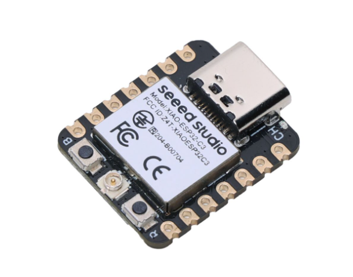
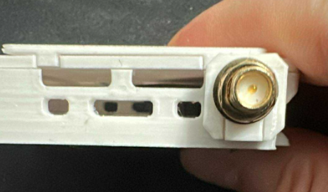
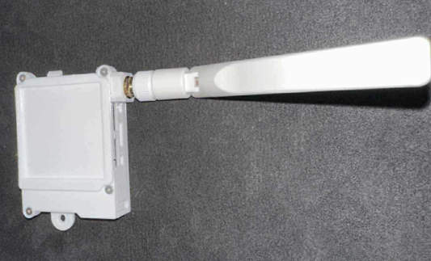
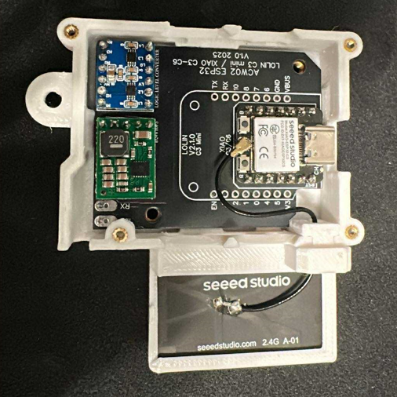
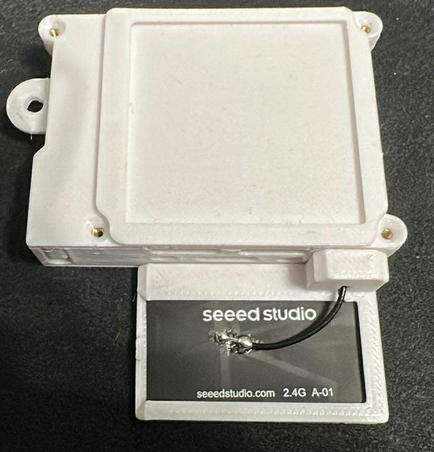
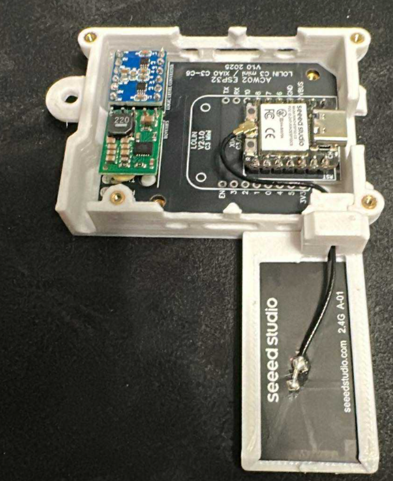
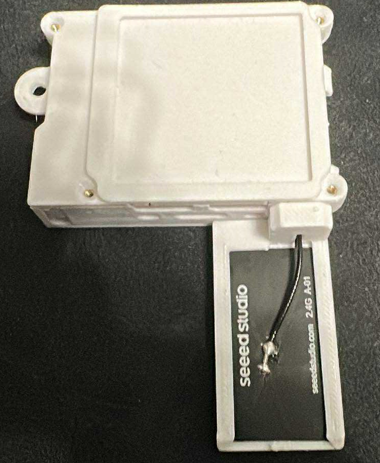
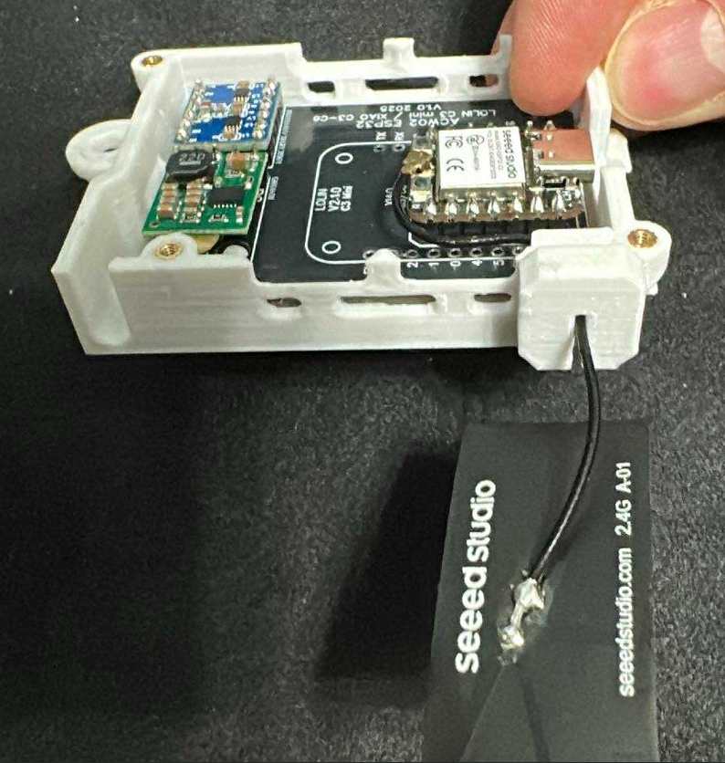
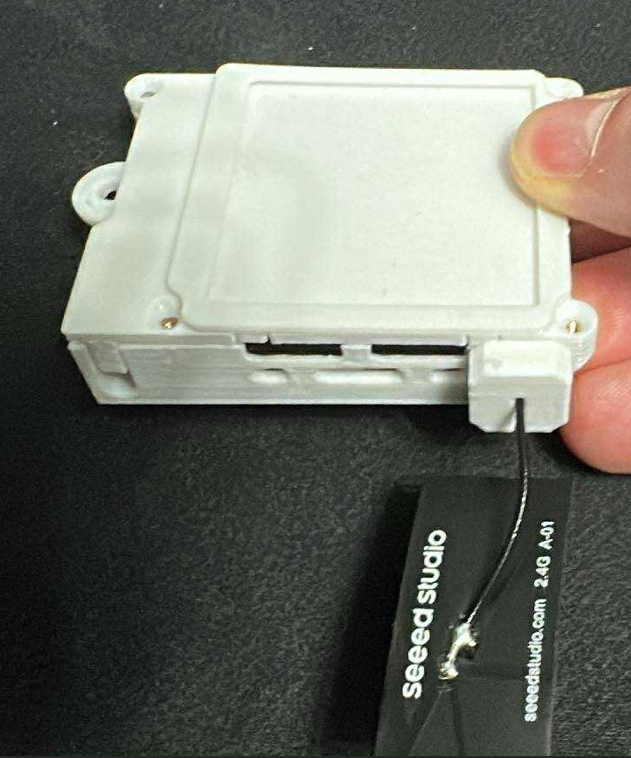

# XIAO ESP32 C3

## 🎯 Carte Compacte avec Antenne Externe

Le **XIAO ESP32 C3** de Seeed Studio offre le meilleur signal Wi-Fi grâce à son support d'antenne externe, dans un format ultra-compact.

---

## 🧩 Carte PCB

### 📂 Fichiers Gerber disponibles dans le répertoire `PCB/` :

#### 🟢 Version stable (v1.0) :
📥 [Télécharger le fichier GERBER](https://github.com/devildant/acw02_esphome/raw/main/PCB/lolin_c3_xiao_c3_xiao_c6/v1.0/Gerber_climEspHome_esp32_lolin_c3_xiao_c3_c6_PCB_climEspHome_esp32_lolin_c3_xiao_c3_2025-09-27.zip)

  


---

## 📦 Composants Nécessaires

### XIAO ESP32 C3
- **[Seeed Studio XIAO ESP32 C3 (x1)](https://www.seeedstudio.com/Seeed-XIAO-ESP32C3-p-5431.html)**  
  

### Antenne Wi-Fi (Recommandée)
- **[Antenne FPC 2.4GHz 2.9dBi pour XIAO (x1)](https://www.seeedstudio.com/2-4GHz-FPC-Antenna-2-9dBi-for-XIAO-ESP32C3-p-6439.html)**  
  

> **💡 Note :** Bien que le XIAO C3 ait une antenne PCB intégrée, l'ajout d'une antenne externe améliore significativement la portée et la stabilité.

### Autres Composants
- **[Régulateur 12V → 5V D24V10F5 (x1)](https://shop.mchobby.be/fr/regulateurs/554--regul-5v-1a-step-down-d24v10f5-3232100005549-pololu.html)**  
- **Convertisseur de Niveau Logique** (même options que ESP32 D1 Mini)
- **[Broches mâles 7 pins 2.54mm (x2)](https://fr.aliexpress.com/item/1005007128029220.html)**  
  

---

## ⚙️ Avantages et Inconvénients

### ✅ Avantages
- **Meilleur signal Wi-Fi** avec antenne externe
- **Format ultra-compact** (21×17.5mm)
- **Architecture RISC-V** moderne et efficace
- **USB-C natif** (pas de convertisseur série)
- **Faible consommation** énergétique
- **Qualité Seeed Studio** (fabricant réputé)

### ❌ Inconvénients
- **Pas de bouton reset** dans le boîtier 3D
- **Prix plus élevé** que les alternatives
- **Disponibilité parfois limitée**
- **Antenne externe nécessaire** pour performances optimales

---

## 🔌 Câblage et Soudure PCB

### Code Couleur des Câbles
- **ROUGE** = 12V  
- **NOIR** = RX  
- **JAUNE** = TX  
- **VERT** = GND

### Schéma de Câblage


### Configuration YAML
```yaml
substitutions:
  # XIAO (Seeed Studio) ESP32 C3
  board: seeed_xiao_esp32c3
  TX: GPIO21
  RX: GPIO20
```

---

## 📡 Configuration de l'Antenne

### Types d'Antennes Supportées

Le boîtier 3D inclut plusieurs options de montage d'antenne :

#### 1. **Antenne Rigide** (Meilleure performance)
- [Support antenne rigide partie A (.stl)](https://github.com/devildant/acw02_esphome/raw/main/3Dfiles/LOLIN-C3-XIAO-C3-C6/support%20antenna%20rigid%20part%20A.stl)
- [Support antenne rigide partie B (.stl)](https://github.com/devildant/acw02_esphome/raw/main/3Dfiles/LOLIN-C3-XIAO-C3-C6/support%20antenna%20rigid%20part%20B.stl)




#### 2. **Antenne Flexible Horizontale**
- [Support antenne flex horizontal (.stl)](https://github.com/devildant/acw02_esphome/raw/main/3Dfiles/LOLIN-C3-XIAO-C3-C6/support%20antenna%20flex%20horizontal.stl)




#### 3. **Antenne Flexible Verticale**
- [Support antenne flex vertical (.stl)](https://github.com/devildant/acw02_esphome/raw/main/3Dfiles/LOLIN-C3-XIAO-C3-C6/support%20antenna%20flex%20vertical.stl)




#### 4. **Antenne Flexible Libre**
- [Support antenne flex libre (.stl)](https://github.com/devildant/acw02_esphome/raw/main/3Dfiles/LOLIN-C3-XIAO-C3-C6/support%20antenna%20flex%20free.stl)




---

## 🔧 Spécifications Techniques

### Microcontrôleur
- **Puce** : ESP32-C3FN4 (RISC-V single-core 160 MHz)
- **Mémoire Flash** : 4 MB
- **RAM** : 400 KB SRAM
- **Wi-Fi** : 802.11 b/g/n (2.4 GHz)
- **Bluetooth** : Bluetooth 5.0 LE

### Connectivité
- **GPIO** : 11 pins numériques
- **ADC** : 4 canaux 12-bit
- **SPI** : 1x SPI
- **I2C** : 1x I2C
- **UART** : 1x UART
- **USB** : USB-C natif

### Antenne
- **Antenne PCB intégrée** : Disponible
- **Connecteur U.FL** : Pour antenne externe
- **Commutation** : Automatique ou manuelle via logiciel

---

## 🖨️ Fichiers 3D pour XIAO ESP32 C3

### Boîtier de Base
Même structure que LOLIN C3 et XIAO C6 :  
`3Dfiles/LOLIN-C3-XIAO-C3-C6/`

### Supports d'Antenne
Tous les supports d'antenne listés dans la section **Configuration de l'Antenne** ci-dessus.

### Support de Soudure
- **[Support de soudure ESP32 C3-C6 (.stl)](https://github.com/devildant/acw02_esphome/raw/main/3Dfiles/LOLIN-C3-XIAO-C3-C6/solder%20board%20ESP32%20C3-C6.stl)**

### 📸 Photos de Montage


---

## 📋 Comparaison Détaillée

| Caractéristique | ESP32 D1 Mini | LOLIN C3 | **XIAO C3** | XIAO C6 |
|------------------|---------------|----------|-------------|---------|
| **Signal Wi-Fi** | ⭐⭐⭐ | ⭐⭐⭐⭐ | ⭐⭐⭐⭐⭐ | ⭐⭐⭐ |
| **Taille** | 34×25mm | 34×25mm | **21×17.5mm** | 21×17.5mm |
| **Bouton Reset** | ✅ | ✅ | ❌ | ❌ |
| **Antenne Externe** | ❌ | ❌ | ✅ | ✅ |
| **USB** | Micro-USB | USB-C | **USB-C** | USB-C |
| **Prix** | €€ | €€€ | **€€€€** | €€€€€ |

---

## 💡 Quand Choisir le XIAO C3

### ✅ Recommandé Si
- **Signal Wi-Fi prioritaire** (climatiseur éloigné du routeur)
- **Espace limité** pour l'installation
- Vous voulez du **matériel moderne** (USB-C, RISC-V)
- **Budget disponible** pour la qualité

### ❌ Éviter Si
- **Budget serré** (ESP32 D1 Mini suffit souvent)
- Vous **devez avoir un bouton reset**
- **Première installation** (commencez par ESP32 D1 Mini)
- L'**antenne externe est gênante** dans votre installation

---

## 🛒 Où Acheter

### 🛒 Fournisseurs Recommandés
- **[Seeed Studio (officiel)](https://www.seeedstudio.com/Seeed-XIAO-ESP32C3-p-5431.html)** - Source directe
- **[DigiKey](https://www.digikey.fr/)** - Distributeur officiel Europe
- **[Mouser](https://www.mouser.fr/)** - Alternative européenne
- **[Kubii](https://www.kubii.fr/)** - Revendeur français

### 💰 Fourchettes de Prix
- **XIAO C3** : 7-10€
- **Antenne FPC** : 3-5€
- **Total** : ~12-15€

---

## 🔧 Installation Spécifique

### 1️⃣ Connexion de l'Antenne
1. **Localiser le connecteur U.FL** sur le XIAO C3
2. **Connecter délicatement** l'antenne FPC (clic audible)
3. **Vérifier la connexion** en tirant légèrement

### 2️⃣ Configuration Logicielle
```yaml
# Configuration automatique - aucun paramètre antenne requis
# Le XIAO C3 détecte automatiquement l'antenne externe
```

### 3️⃣ Test de Signal
```yaml
# Ajoutez temporairement pour tester
sensor:
  - platform: wifi_signal
    name: \"Signal Wi-Fi\"
    update_interval: 60s
```

---

## 🔗 Prochaines Étapes

1. **[Commander le matériel](https://www.seeedstudio.com/Seeed-XIAO-ESP32C3-p-5431.html)**
2. **[Télécharger les supports d'antenne](../../hardware/3d-files/)**
3. **[Configurer ESPHome](../installation/)** avec les bons paramètres
4. **[Assembler le module complet](../usage/configuration.md)**

---

## 📞 Support et Ressources

- **[Wiki Seeed Studio](https://wiki.seeedstudio.com/XIAO_ESP32C3_Getting_Started/)**
- **[Forum ESPHome](https://community.home-assistant.io/c/esphome/)**
- **[Schéma pinout officiel](https://wiki.seeedstudio.com/XIAO_ESP32C3_Getting_Started/)**