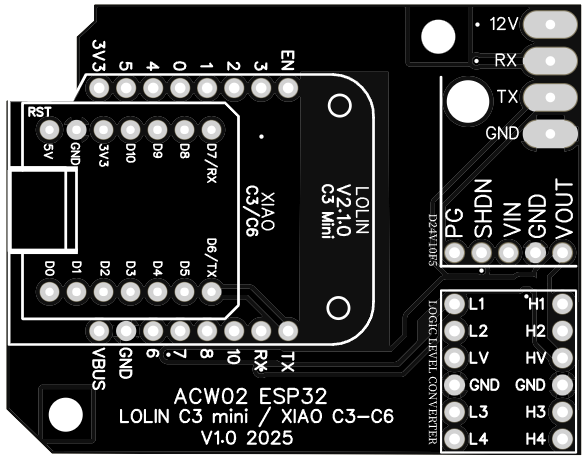
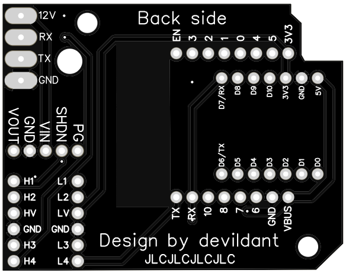
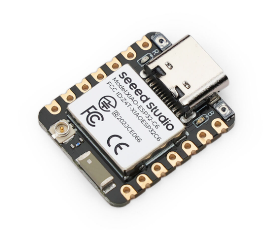
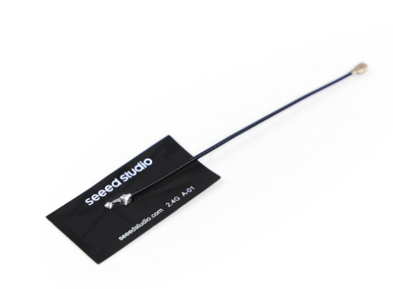

# XIAO ESP32 C6

## ⚠️ Carte Avancée - Antenne Externe Obligatoire

Le **XIAO ESP32 C6** est la version la plus récente avec Wi-Fi 6, mais **nécessite absolument** une antenne externe car l'antenne interne a une réception très faible.

---

## 🧩 Carte PCB

### 📂 Fichiers Gerber disponibles dans le répertoire `PCB/` :

#### 🟢 Version stable (v1.0) :
📥 [Télécharger le fichier GERBER](https://github.com/devildant/acw02_esphome/raw/main/PCB/lolin_c3_xiao_c3_xiao_c6/v1.0/Gerber_climEspHome_esp32_lolin_c3_xiao_c3_c6_PCB_climEspHome_esp32_lolin_c3_xiao_c3_2025-09-27.zip)

  


---

## 📦 Composants Nécessaires

### XIAO ESP32 C6
- **[Seeed Studio XIAO ESP32 C6 (x1)](https://www.seeedstudio.com/Seeed-Studio-XIAO-ESP32C6-p-5884.html)**  
  

### ⚠️ Antenne Wi-Fi (OBLIGATOIRE)
- **[Antenne FPC 2.4GHz 2.9dBi pour XIAO (x1)](https://www.seeedstudio.com/2-4GHz-FPC-Antenna-2-9dBi-for-XIAO-ESP32C3-p-6439.html)**  
  

> **🚨 IMPORTANT :** L'antenne interne du C6 a une réception très faible. L'antenne externe n'est pas optionnelle mais **obligatoire** pour un fonctionnement correct.

### Autres Composants
- **[Régulateur 12V → 5V D24V10F5 (x1)](https://shop.mchobby.be/fr/regulateurs/554--regul-5v-1a-step-down-d24v10f5-3232100005549-pololu.html)**  
- **Convertisseur de Niveau Logique** (même options que ESP32 D1 Mini)
- **[Broches mâles 7 pins 2.54mm (x2)](https://fr.aliexpress.com/item/1005007128029220.html)**  
  

---

## ⚙️ Avantages et Inconvénients

### ✅ Avantages
- **Wi-Fi 6 (802.11ax)** - Standard le plus récent
- **Architecture RISC-V** très moderne
- **Format ultra-compact** (21×17.5mm)
- **USB-C natif** haute vitesse
- **Thread/Zigbee** support (pas utilisé dans ce projet)
- **Efficacité énergétique** optimisée

### ❌ Inconvénients
- **Antenne externe OBLIGATOIRE** (coût et complexité supplémentaires)
- **Signal Wi-Fi faible** avec antenne interne (inutilisable)
- **Prix le plus élevé** de toutes les options
- **Pas de bouton reset** dans le boîtier 3D
- **Disponibilité limitée** (plus récent)
- **Moins testé** que les autres versions

---

## 🔌 Câblage et Soudure PCB

### Code Couleur des Câbles
- **ROUGE** = 12V  
- **NOIR** = RX  
- **JAUNE** = TX  
- **VERT** = GND

### Schéma de Câblage


### Configuration YAML
```yaml
substitutions:
  # XIAO (Seeed Studio) ESP32 C6
  board: seeed_xiao_esp32c6
  TX: GPIO16
  RX: GPIO17
```

> **📝 Note :** Les pins UART sont différentes du C3 (GPIO16/17 au lieu de GPIO21/20).

---

## 📡 Configuration de l'Antenne (OBLIGATOIRE)

### ⚠️ Avertissement Signal
Sans antenne externe, vous obtiendrez :
- **Signal Wi-Fi < -80 dBm** (très faible)
- **Connexions instables** ou impossibles
- **Déconnexions fréquentes**

### Types d'Antennes Supportées

Même options que le XIAO C3, mais **l'une d'elles est obligatoire** :

#### 1. **Antenne Rigide** (Performance maximale - recommandé)
- [Support antenne rigide partie A (.stl)](https://github.com/devildant/acw02_esphome/raw/main/3Dfiles/LOLIN-C3-XIAO-C3-C6/support%20antenna%20rigid%20part%20A.stl)
- [Support antenne rigide partie B (.stl)](https://github.com/devildant/acw02_esphome/raw/main/3Dfiles/LOLIN-C3-XIAO-C3-C6/support%20antenna%20rigid%20part%20B.stl)

#### 2. **Antenne Flexible** (Plus discrète)
- [Support antenne flex horizontal (.stl)](https://github.com/devildant/acw02_esphome/raw/main/3Dfiles/LOLIN-C3-XIAO-C3-C6/support%20antenna%20flex%20horizontal.stl)
- [Support antenne flex vertical (.stl)](https://github.com/devildant/acw02_esphome/raw/main/3Dfiles/LOLIN-C3-XIAO-C3-C6/support%20antenna%20flex%20vertical.stl)
- [Support antenne flex libre (.stl)](https://github.com/devildant/acw02_esphome/raw/main/3Dfiles/LOLIN-C3-XIAO-C3-C6/support%20antenna%20flex%20free.stl)

---

## 🔧 Spécifications Techniques

### Microcontrôleur
- **Puce** : ESP32-C6FH4 (RISC-V single-core 160 MHz)
- **Co-processeur** : LP-Core RISC-V 20 MHz
- **Mémoire Flash** : 4 MB
- **RAM** : 512 KB SRAM
- **Wi-Fi** : 802.11ax/b/g/n (Wi-Fi 6, 2.4 GHz)
- **Bluetooth** : Bluetooth 5.3 LE
- **Thread/Zigbee** : IEEE 802.15.4

### Connectivité
- **GPIO** : 23 pins numériques
- **ADC** : 7 canaux 12-bit  
- **SPI** : 2x SPI
- **I2C** : 2x I2C
- **UART** : 3x UART
- **USB** : USB 2.0 full-speed

### Performance Wi-Fi
- **Débit théorique** : Jusqu'à 150 Mbps (Wi-Fi 6)
- **Sensibilité** : -97 dBm @ 11 Mbps (avec antenne externe)
- **Puissance TX** : 22 dBm max

---

## 📋 Comparaison Complète

| Caractéristique | ESP32 D1 Mini | LOLIN C3 | XIAO C3 | **XIAO C6** |
|------------------|---------------|----------|---------|-------------|
| **Wi-Fi Standard** | 802.11n | 802.11n | 802.11n | **802.11ax (Wi-Fi 6)** |
| **Signal (antenne externe)** | N/A | N/A | ⭐⭐⭐⭐⭐ | **⭐⭐⭐⭐** |
| **Signal (interne)** | ⭐⭐⭐ | ⭐⭐⭐⭐ | ⭐⭐⭐⭐ | **❌ Inutilisable** |
| **Bouton Reset** | ✅ | ✅ | ❌ | **❌** |
| **Prix** | €€ | €€€ | €€€€ | **€€€€€** |
| **Maturité** | ⭐⭐⭐⭐⭐ | ⭐⭐⭐⭐ | ⭐⭐⭐ | **⭐⭐** |

---

## 💡 Quand Choisir le XIAO C6

### ✅ Recommandé Si
- Vous voulez la **technologie la plus récente** (Wi-Fi 6)
- **Budget élevé** et priorité à la performance
- Environnement avec **routeurs Wi-Fi 6** récents
- **Installation permanente** (antenne externe acceptable)
- Vous êtes un **utilisateur expérimenté**

### ❌ Éviter Si
- **Budget limité** (optez pour ESP32 D1 Mini ou LOLIN C3)
- **Première installation** (commencez par quelque chose de plus simple)
- **Antenne externe gênante** dans votre installation
- Votre routeur Wi-Fi est **ancien** (pas de Wi-Fi 6)
- Vous voulez la **solution la plus testée**

---

## 🚨 Points d'Attention Importants

### 1. **Antenne Obligatoire**
- ❌ **N'achetez PAS** le C6 sans antenne externe
- 🔧 **Commandez l'antenne** en même temps que la carte
- 📏 **Prévoyez l'espace** pour l'antenne dans votre installation

### 2. **Configuration Différente**
```yaml
# ATTENTION: Pins UART différentes du C3
# XIAO C6
TX: GPIO16  # ≠ C3 (GPIO21)
RX: GPIO17  # ≠ C3 (GPIO20)
```

### 3. **Prix Total**
- **XIAO C6** : ~15€
- **Antenne** : ~5€  
- **Total** : ~20€ (vs 8€ pour ESP32 D1 Mini)

---

## 🛒 Où Acheter

### 🛒 Fournisseurs Recommandés
- **[Seeed Studio (officiel)](https://www.seeedstudio.com/Seeed-Studio-XIAO-ESP32C6-p-5884.html)** - Source directe
- **[DigiKey Europe](https://www.digikey.fr/)** - Distributeur officiel
- **[Mouser Europe](https://www.mouser.fr/)** - Alternative fiable

### ⚠️ Évitez
- **Sites inconnus** (risque de contrefaçons)
- **Vendeurs sans antenne** disponible
- **Prix trop bas** (< 12€ suspect)

---

## 🔧 Installation Spécifique

### 1️⃣ Assemblage Antenne
1. **Connecter l'antenne U.FL** AVANT de souder
2. **Tester la connexion** avant montage final
3. **Orienter l'antenne** selon le support 3D choisi

### 2️⃣ Test de Signal
```yaml
# Vérifiez votre signal après installation
sensor:
  - platform: wifi_signal
    name: \"Signal Wi-Fi C6\"
    update_interval: 30s
    
text_sensor:
  - platform: wifi_info
    ssid:
      name: \"SSID Connecté\"
```

### 3️⃣ Optimisation Wi-Fi 6
```yaml
# Configuration ESPHome pour Wi-Fi 6 (optionnel)
wifi:
  ssid: !secret wifi_ssid
  password: !secret wifi_password
  # Forcer le mode Wi-Fi 6 si supporté par votre routeur
  output_power: 20dB
  fast_connect: true
```

---

## 🔗 Prochaines Étapes

1. **[Acheter le kit complet](https://www.seeedstudio.com/Seeed-Studio-XIAO-ESP32C6-p-5884.html)** (carte + antenne)
2. **[Télécharger les supports d'antenne](../../hardware/3d-files/)**
3. **[Configurer avec les bons paramètres](../installation/)**
4. **[Tester le signal Wi-Fi](../usage/troubleshooting.md)**

---

## 📞 Support et Ressources

- **[Wiki officiel Seeed Studio](https://wiki.seeedstudio.com/xiao_esp32c6_getting_started/)**
- **[Comparaison C3 vs C6](https://wiki.seeedstudio.com/SeeedStudio_XIAO_Series_Introduction/)**
- **[Forum ESPHome](https://community.home-assistant.io/c/esphome/)**